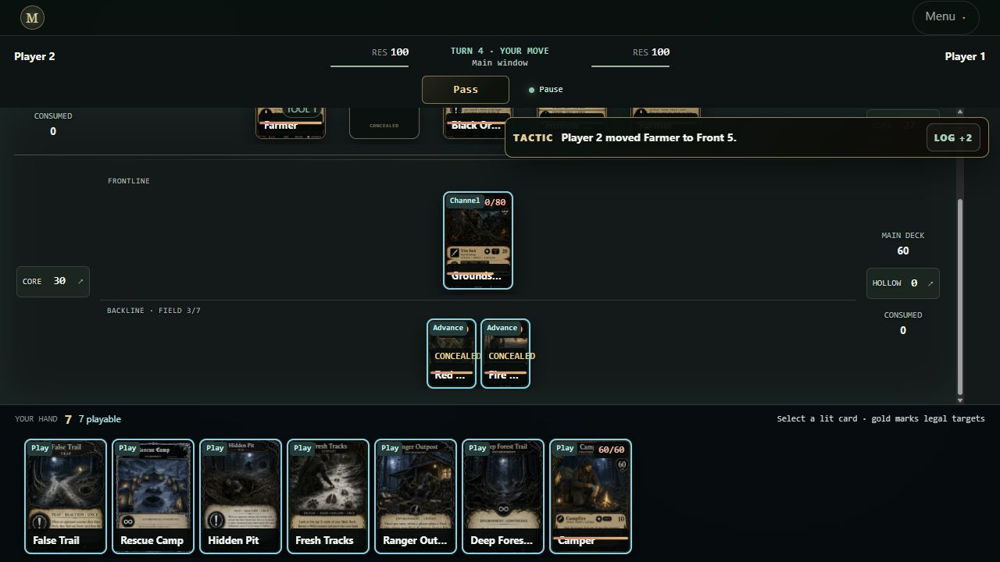
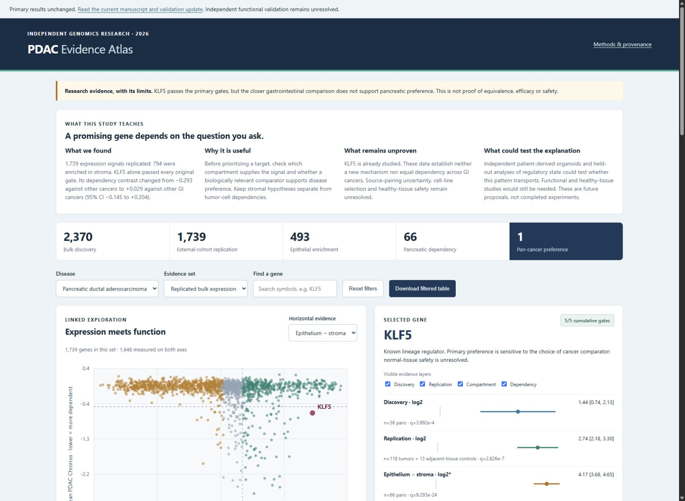
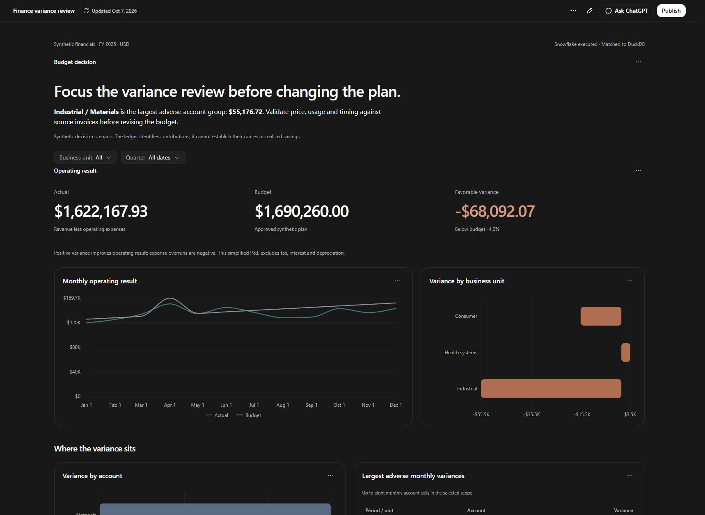
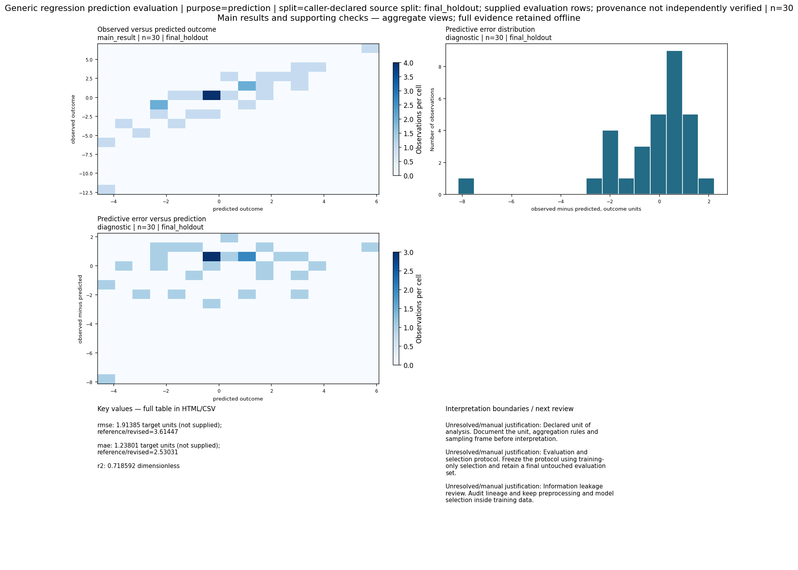

# James Jean · Projects in use

I build analytical tools and applications that make complex work easier to inspect, explain and use. This gallery connects each project to a concrete problem, an interface or result, and the evidence behind it.

**Research data · Python · R · SQL · Statistical analysis · Product engineering**

[Professional profile](https://github.com/S3R3Bii) · [Publications](https://github.com/S3R3Bii/S3R3Bii/blob/main/PUBLICATIONS.md) · [Interactive portfolio](https://james-jean-data-science.s3r3bii.chatgpt.site)

## Research directed at demanding data roles

The [50-study research register](research-program/README.md) connects specific business questions to public data and measurable tests. The [skills map](research-program/SKILLS_AND_SEQUENCE.md) emphasizes SQL, data validation, temporal evaluation, model tuning, kinematics and decision communication. The register separates three released studies, one executed study with a reproducibility hold, and 46 unexecuted protocols. Every model-selection claim requires retained optimization and independent metric evidence.

## Start here

| Project | What to look for |
|---|---|
| [Complaint capacity forecasting](https://github.com/S3R3Bii/complaint-capacity-forecasting) | SQL lineage, 15-candidate model comparison, temporal validation and decision uncertainty |
| [Acceleration reconstruction across roads](https://github.com/S3R3Bii/brake-signal-transfer) | 246,144 source rows, 18-candidate search, held-out-road MSE and the tradeoff between error and missed braking frames |
| [Funding-alert burden](https://github.com/S3R3Bii/funding-alert-burden) | Exact SQL rate joins, 18 monitoring configurations, a protected later period and independent case-level detection checks |
| [PikiVu](pikivu.md) | A compact recording interface and validated edit/export workflow |
| [Model Evidence](model-evidence.md) | Statistical diagnostics presented as readable reports |
| [Open Research Commons](open-research-commons.md) | Shared human/agent workflow with independent release checks |
| [PostgreSQL Data Integrity](postgresql-data-integrity.md) | Executed SQL, rollback tests and Python reconciliation |
| [Mathematical Portfolio Study](mathematical-portfolio-study.md) | A real negative result that changes the recommended method |

## See the work

<table><tr><td width="50%"> <b>MIMIC — game engineering</b></td><td width="50%"> <b>PDAC — an evidence-first research interface</b></td></tr><tr><td> <b>Finance analytics — synthetic decision case</b></td><td> <b>Model Evidence — readable statistical checks</b></td></tr></table>

## Product engineering

| Project | Demonstrated work |
|---|---|
| [PikiVu](pikivu.md) | A Windows recording and editing application that preserves original media while turning captured sessions into reviewable exports. |
| [JeanAcres Owner Reporting](jeanacres-owner-reporting.md) | Built an owner-reporting application that assembles operational summaries from normalized sales and stock inputs. The example report was generated by the application using an explicitly synthetic test fixture. |
| [MIMIC — The Living Card Game](mimic-the-living-card-game.md) | Built a deterministic TypeScript card-game system with 306 governed cards, legal-action enumeration, shared action reduction and replay state hashes. The Vite interface and Electron package use the same runtime. |
| [THE MANY](the-many.md) | Built a deterministic asymmetric survival game with React/Vite presentation and a Fastify authority, separating authoritative state from player projections. |
| [Patient Data Tracking Dashboard](patient-data-tracking-dashboard.md) | Created a Streamlit recording-inventory interface to summarize gait and pull-table processing status. The demonstration uses synthetic records. |
| [WiFi Signal Lab](wifi-signal-lab.md) | Explored read-only WLAN signal strength, channel and link-rate collection on a Windows PC. |
| [HUD234](hud234.md) | A compact Windows overlay showing task completion, blockers and requested user actions. A local collector reads specific task receipts and file updates. |
| [Agent Aegis](agent-aegis.md) | A browser application for organizing marketing-review workflows, audit events and evidence packets. |
| [Current Snapshot Finance Dashboard](current-snapshot-finance-dashboard.md) | A personal-finance interface that brings accounts, spending, cash flow and financial goals into one navigable view. |
| [Data Science Video Studio](data-science-video-studio.md) | A local prototype for turning analytical material into structured teaching-video previews. |
| [Data Science Portfolio Website](data-science-portfolio-website.md) | A frontend that makes research and product work browsable through concise explanations, visuals and supporting evidence. |
| [Cluey Product Briefing](cluey-product-briefing.md) | A structured product-briefing package that organizes a proposed assistant workflow and its intended use. |

## Research and data tools

| Project | Demonstrated work |
|---|---|
| [Model Evidence](model-evidence.md) | A Python and R toolkit that turns supported fitted-model checks into readable diagnostic reports and traceable result tables. |
| [Open Research Commons](open-research-commons.md) | A shared research record for people and agents: define a question, attach evidence, run a supported analysis, inspect independent checks and publish a frozen result. |
| [Battery-to-Aircraft Feasibility](battery-to-aircraft-feasibility.md) | Built ingestion and feasibility-analysis workflows for cell measurements and aircraft mission constraints. A historical quality report records 21 partial time-series parses and a failed voltage-range check. |
| [Kalshi Weather Evidence and Paper Models](kalshi-weather-evidence-and-paper-models.md) | Built coherent weather-threshold probability and settlement-evidence workflows, with chronological paper-ledger checks and freshness-based abstention. |
| [International Migration Visualization](international-migration-visualization.md) | Combined ACS, UN DESA, DEMIG and World Bank material while keeping migration stocks, flows and their definitions distinct. |
| [Data Science Decision Reference](data-science-decision-reference.md) | Created a 38-page decision guide connecting analytical questions to methods, evidence requirements and delivery checks. The atlas presents 22 routes, 137 decision nodes and 274 yes/no branches. |
| [Snowflake Finance Analytics](snowflake-finance-analytics.md) | Turn a reconciled ledger into a focused variance review, with the evidence available for inspection. |
| [Mathematical Portfolio Study](mathematical-portfolio-study.md) | Separate numerical accuracy, identification and predictive adequacy before choosing a remedy. |
| [PDAC Genomics Evidence](pdac-genomics-evidence.md) | Make evidence attrition, coverage and comparator sensitivity explicit before advancing a biological claim. |
| [Optimizer Budget and Measurement Study](optimizer-budget-and-measurement-study.md) | Four controlled experiments compare how to spend a limited optimization budget, including 100, 500 and 1,000 variables. |
| [PostgreSQL Data Integrity](postgresql-data-integrity.md) | Transactional batch loading, analytical SQL and independent reconciliation using a fictional research-data fixture. |
| [Universal EDA Pipeline](universal-eda-pipeline.md) | Reusable Python helpers for inspecting missingness, duplicates, distributions and early modeling assumptions. |
| [Agent Evaluation Workbench](agent-evaluation-workbench.md) | A local workbench for comparing agent outputs against explicit task evidence and keeping failed checks visible. |
| [Certified Analysis Decision Revision](certified-analysis-decision-revision.md) | Research on checking whether locked analytical decisions change after bounded updates to their supporting evidence. |
| [Market Data Observatory](market-data-observatory.md) | A research pipeline for monitoring public financial data, source freshness and paper-only analytical results. |
| [Video Visualization Toolkit](video-visualization-toolkit.md) | Reusable visual-production work supporting data explanations and video-based presentation. |
| [Pokemon TCG Strategy Research](pokemon-tcg-strategy-research.md) | Independent work on game-state representation, simulation and strategy analysis. |

## Public-data analysis

| Project | Demonstrated work |
|---|---|
| [Daily Data Stories: Global Clean Electricity](daily-data-stories-global-clean-electricity.md) | Analyzed Ember annual global electricity-generation history from 2000 through 2025, comparing fossil and clean generation. |
| [Daily Data Stories: Digital Divide](daily-data-stories-digital-divide.md) | Compared ITU internet-use estimates by income group. |
| [Daily Data Stories: Safe Water Gap](daily-data-stories-safe-water-gap.md) | Compared rural and urban safely managed drinking-water estimates. |
| [Daily Data Stories: Temperature Record](daily-data-stories-temperature-record.md) | Analyzed NASA GISTEMP annual temperature anomalies over 146 complete years, preserving published ties and comparing the recent decade with the historical distribution. |
| [Daily Data Stories: GDP and Longevity](daily-data-stories-gdp-and-longevity.md) | Compared PPP GDP per person with life expectancy across 195 economies in 2024 using a descriptive log-linear fit and an illustrative Sri Lanka–South Africa comparison. |
| [Daily Data Stories: World Population Projections](daily-data-stories-world-population-projections.md) | Explained the UN World Population Prospects 2024 median projection and its 80% and 95% prediction intervals, distinguishing historical estimates from model-based projections. |
| [Daily Data Stories: Growth Across Incomes](daily-data-stories-growth-across-incomes.md) | Compared Brazil’s 2019 and 2024 income distributions using the March 2026 World Bank PIP release. Compound growth of group means was 4.8% per year for the lower 40% and 0.7% for the upper 10%. |
| [Daily Data Stories: Food Price Forecast Test](daily-data-stories-food-price-forecast-test.md) | Tested retrospective one-step food-price forecasts against simple baselines. |
| [Daily Data Stories: Child Survival](daily-data-stories-child-survival.md) | Compared 1990 and 2024 under-five mortality point estimates for 196 matched economies. Estimates were lower in 194, while distribution summaries retained equal economy weights. |
| [Daily Data Stories: R Demographic Trajectories](daily-data-stories-r-demographic-trajectories.md) | Used an executed R workflow to compare selected demographic trajectories. |
| [Daily Data Stories: Minimum Wage and Jobs](daily-data-stories-minimum-wage-and-jobs.md) | Reproduced a historical border-county restaurant-employment analysis and checked prediction baselines. |

## Creative and scholarly work

| Project | Demonstrated work |
|---|---|
| [A Vessel for a Soul](a-vessel-for-a-soul.md) | A book-length inquiry into consciousness, physical organization and moral responsibility, with computational reader companions. |

## About the evidence

Screenshots are actual interface captures or generated analytical outputs, not invented product mockups. Synthetic examples and historical snapshots are labeled on their project pages. Independent projects include AI-assisted development; professional research contributions are documented separately in the publications list.

This repository is a public showcase. Proprietary product code, client and patient data, private recordings, financial information, credentials, job-search records and school assignments are not included. Selected safe source projects are linked separately.

© James N. Jean IV. Product images and original prose are provided for portfolio review. Linked projects and third-party data retain their own licenses.
