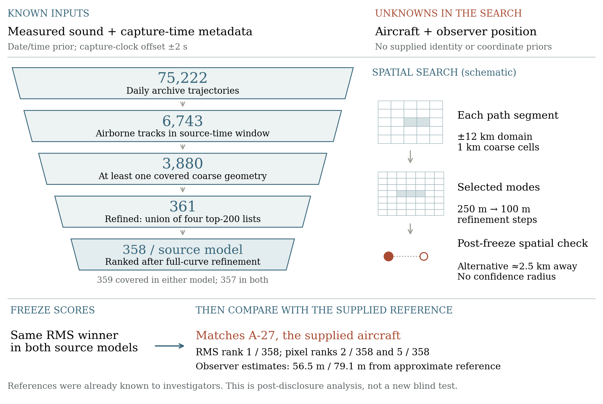
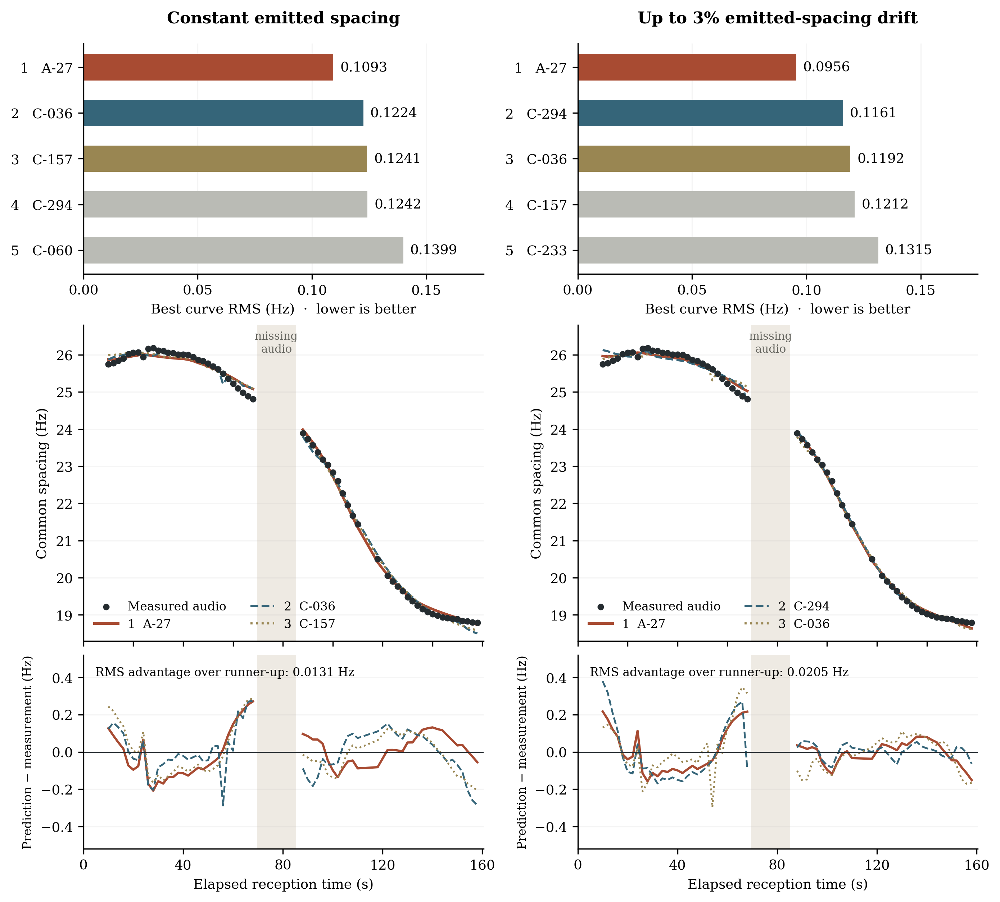
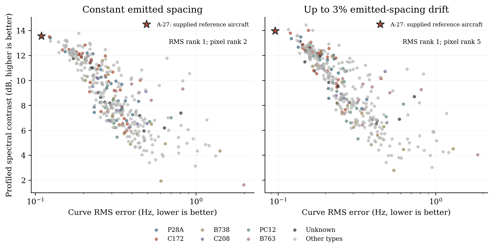
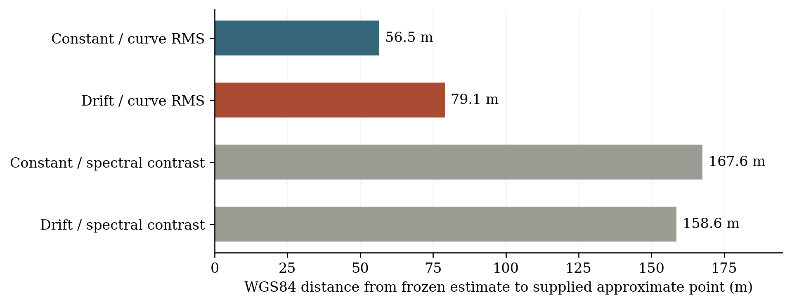

# Aircraft sound as a geolocation signal
## Capture-time inference and retrospective validation
**James N. Jean IV · Applied signal processing and inverse problems**

[Technical manuscript](projects/aircraft-doppler-geolocation/Audio_Location_Public.pdf) · [Single executed Python notebook](projects/aircraft-doppler-geolocation/notebooks/Aircraft_Audio_Geolocation.ipynb) · [Project ZIP](projects/aircraft-doppler-geolocation/Aircraft_Audio_Public_Project.zip)

> A short recording contains measurable Doppler structure. This project tests how much that structure can tell us about the aircraft and the observer, and where a favorable fit can still mislead.

## Study design
The analysis uses capture timestamps and a global aircraft-trajectory archive. It was performed after the participant supplied aircraft identity and an approximate location. Those values were excluded from fitting inputs; this is a **post-disclosure retrospective analysis, not a blind experiment**. The supplied target is anonymized as A-27.

## Abstract
Two clips of one flyover were aligned on a shared reception-time axis, preserving the unrecorded interval. Sixty-two harmonic-spacing measurements were compared with three-dimensional trajectory predictions incorporating acoustic travel time, atmosphere and bounded source-pitch behavior. The capture-time coarse search examined 6,743 aircraft; 3,880 had coarse coverage. A union of top-ranked candidates across two source models and two objectives selected 361 for refinement. Of these, 359 had coverage under at least one model and 358 were ranked for each objective/model.

The supplied aircraft ranked first by curve RMS under both source models and second/fifth by spectral contrast. Its curve-optimal inferred observer points were approximately **56.5 m and 79.1 m** from the participant's approximate reference. These are encouraging retrospective results, not confidence radii or proof of unique identification. An alternative near-optimal spatial basin remains, and a preregistered blind replication is required.



## Why the top candidate ranks first
The five lowest curve-error scores and the top three actual prediction curves are shown below. Each aircraft is compared at its own best retained location, clock and pitch parameters. A-27 has the smallest RMS in both models; its advantages of 0.0131 Hz and 0.0205 Hz over the runners-up are numerical preferences, not calibrated exclusion thresholds. The close alternatives and full residuals remain visible.



## Research questions
1. What information survives in a real harmonic-spacing curve?
2. How do slant range, propagation delay, wind and source pitch alter the prediction?
3. Does the preferred aircraft survive changes in objective and modeling assumptions?
4. How far are frozen predictions from a subsequently used reference location?

## Method
| Stage | Calculation | Guardrail |
|---|---|---|
| Capture-time audit | Verify original capture metadata and the two-clip interval | Keep acquisition time distinct from file-transfer time |
| Measurement | Review 62 common-spacing observations | Spacing is not automatically an engine fundamental |
| Clip alignment | Preserve approximately 15.16 s of missing recording | A gap is neither silence nor another flyover |
| Propagation | Solve retarded emission time and three-dimensional range | Altitude alone is not slant distance |
| Coarse search | Compare capture-window trajectories over covered geometry | State archive and model coverage |
| Refinement | Union of top 200 aircraft per model/objective | Do not select by known identity or location |
| Validation | Freeze predictions, then calculate scalar reference errors | Post-disclosure analysis is not blind |

## Results
| Source model | Objective | A-27 rank | Reference separation |
|---|---|---:|---:|
| Constant pitch | Curve RMS | 1 / 358 | 56.5 m |
| Up to 3% drift | Curve RMS | 1 / 358 | 79.1 m |
| Constant pitch | Spectral contrast | 2 / 358 | 167.6 m |
| Up to 3% drift | Spectral contrast | 5 / 358 | 158.6 m |

Lower curve RMS and higher spectral contrast are preferred. Spectral ranking is among retained ridge-screened geometry modes, **not an independent exhaustive spectral optimization**. Ranks are not probabilities. Aircraft type labels come from archive metadata, not an acoustic classifier.

The reference location is approximate. No calibrated 95% radius or unique observer pin follows from these distances; the private diagnostics retain another near-optimal basin roughly 2.5 km away.





## Observer geometry and recording conditions
Aircraft altitude, ground elevation and microphone height are separate quantities. Observer altitude is ground elevation plus microphone height; the vertical gap to the aircraft combines with horizontal separation to form three-dimensional slant range. Acoustic travel time is evaluated along that propagation geometry rather than treating altitude as distance.

Low-frequency aircraft sound may remain measurable inside a building, depending on construction, openings, background noise and recording hardware. That physical possibility is not validation of an indoor location or of this particular recording. The manuscript discusses the transmission limits and supporting references.

## Run the single notebook
Download [Aircraft_Audio_Geolocation.ipynb](projects/aircraft-doppler-geolocation/notebooks/Aircraft_Audio_Geolocation.ipynb), then:

```bash
python -m pip install numpy pandas matplotlib jupyterlab ipykernel
jupyter lab Aircraft_Audio_Geolocation.ipynb
```

Choose **Restart Kernel and Run All Cells**. The notebook embeds its sanitized CSV/JSON tables and propagation functions. No other project files or network access are needed to reproduce its retained-data figures and synthetic physics checks after installing dependencies.

The walkthrough follows measured sound and its missing interval, the search/refinement funnel, all 361 retained candidates, scalar validation, observer geometry and synthetic tests. Executed outputs are included.

**Star markers identify A-27, the supplied reference aircraft.** They do not mark observer positions or statistical significance. The funnel's spatial grids are schematic, not confidence regions.

This one file does **not** reproduce original private audio extraction or the full trajectory/environment search; those require separately archived private inputs. Synthetic checks verify equation consistency, not real-world localization accuracy.

## Repository guide
- `notebooks/Aircraft_Audio_Geolocation.ipynb`: single executed, embedded-input walkthrough.
- `data/`: relative-time measurements, corrected candidate scores and scalar validation.
- `src/`, `tests/`: propagation code and consistency tests.
- `manuscript/`: LaTeX source and figure assets.
- `Audio_Location_Public.pdf`: current readable report.
- `Aircraft_Audio_Public_Project.zip`: portable source and evidence package.

## Limitations and next experiment
This is one retrospective event with uncertainty in source behavior, atmosphere, timing, coverage and geometric identifiability. The next experiment should preregister model choices, collect independent recordings and withhold identity and reference coordinates until predictions are frozen.

The public edition omits recordings, exact recording date/time, aircraft identifiers, geographic tracks and observer coordinates. Private evidence is archived separately. No general forensic-service accuracy claim is made.

## Sources
- [ADSB.lol archive](https://github.com/adsblol/globe_history_2026)
- [NOAA ETOPO 2022](https://www.ncei.noaa.gov/products/etopo-global-relief-model)
- NCEP GFS atmospheric fields; retrieval and assumptions in the manuscript.
- [Original methodological video](https://youtu.be/UytYrhYLOKI), credited as inspiration, not validation of this test.

[Back to portfolio](README.md)
