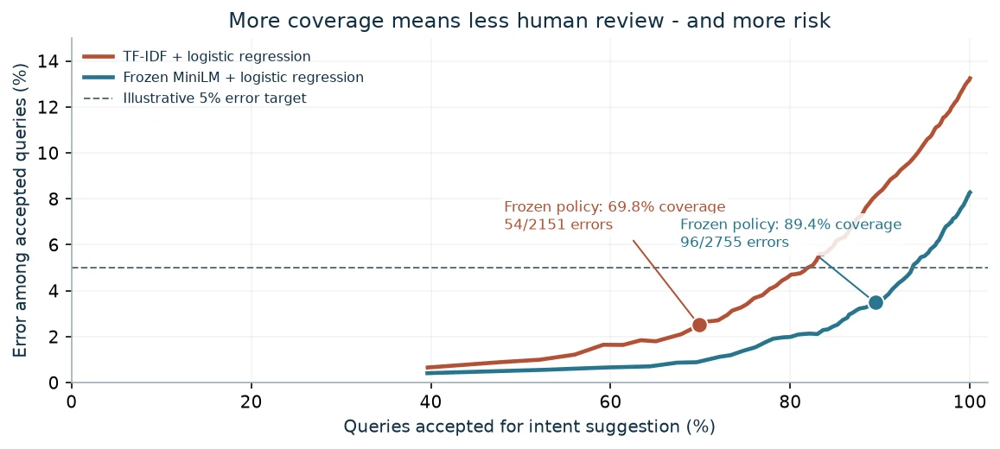

# Banking Intent Atlas

**Knowing when an NLP router should defer.** An executed Python/SQL workflow compares word TF-IDF with frozen MiniLM embeddings across 77 banking intents, calibrates probabilities and locks a human-review policy before final testing.

The encoder reached **91.7% top-1 accuracy** on 3,080 test queries. Its frozen policy accepted **89.4%** with **3.5% error among accepted suggestions** (95% Wilson interval: 2.9–4.2%). Two of twelve synthetic non-banking probes were also accepted: a visible reason to add a validated domain gate before a supervised pilot.

[Explore the interactive decisions](https://james-jean-data-science.s3r3bii.chatgpt.site/assets/banking-intent-atlas/index.html) · [Read the visual paper](projects/banking-intent-atlas/showcase/Banking_Intent_Atlas.pdf) · [Code, SQL and evidence](projects/banking-intent-atlas/README.md)

*Independent, substantially AI-assisted benchmark work. No production adoption, banking automation, cost saving or prior professional NLP tenure is claimed.*

See the [complete project README](projects/banking-intent-atlas/README.md) for pinned sources, the frozen protocol, reproduction commands and limits.

