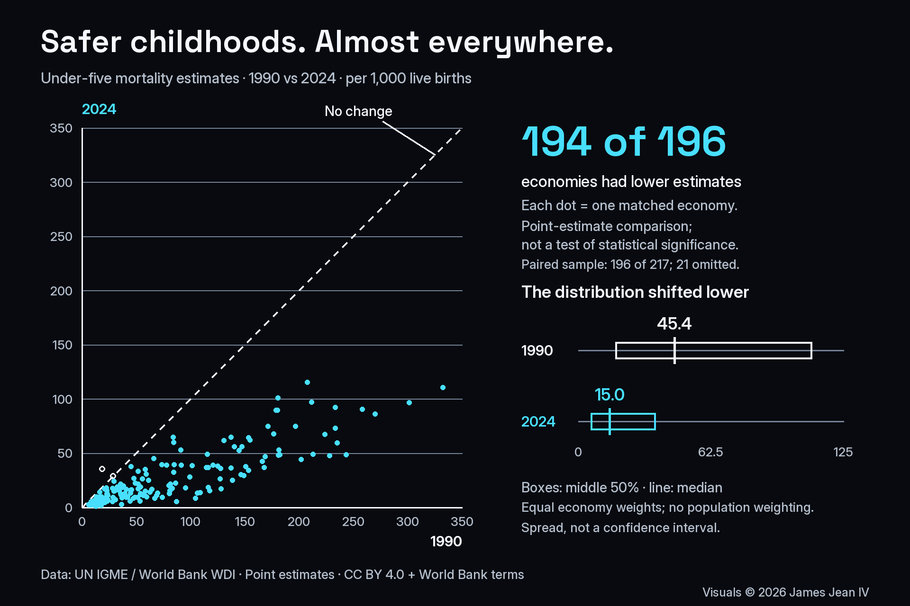

# Daily Data Stories: Child Survival

Compared 1990 and 2024 under-five mortality point estimates for 196 matched economies. Estimates were lower in 194, while distribution summaries retained equal economy weights.

**Evidence snapshot:** Executed public-data analysis

UN IGME via World Bank WDI; 1990 and 2024 point estimates, per 1,000 live births. Matched sample: 196 of 217 economies, equal weights. Data: CC BY 4.0 with World Bank terms. Distribution spread is not a confidence interval. Original visual by James Jean IV.

## What the work demonstrates

Public-data case study

## Scope and next step

Point-estimate comparisons do not establish statistical significance or causal effects. The matched sample omits 21 economies and is not population-weighted. Saved executed notebook; helper scripts and raw snapshots are omitted, so this extract is not standalone runnable. No analysis was rerun for this portfolio update.

## Explore

- [Case study](https://james-jean-data-science.s3r3bii.chatgpt.site/assets/project-downloads/daily-data-stories/2026-09-25-child-survival/case-study.md)
- [Saved executed notebook](https://james-jean-data-science.s3r3bii.chatgpt.site/assets/project-downloads/daily-data-stories/2026-09-25-child-survival/analysis/child_survival.ipynb)
- [Methodology](https://james-jean-data-science.s3r3bii.chatgpt.site/assets/project-downloads/daily-data-stories/2026-09-25-child-survival/methodology.md)
- [Sources and reuse](https://james-jean-data-science.s3r3bii.chatgpt.site/assets/project-downloads/daily-data-stories/2026-09-25-child-survival/REUSE.md)

[Back to the project gallery](README.md)
