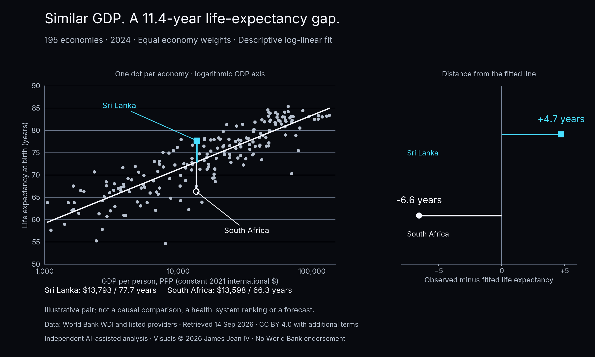

# Daily Data Stories: GDP and Longevity

Compared PPP GDP per person with life expectancy across 195 economies in 2024 using a descriptive log-linear fit and an illustrative Sri Lanka–South Africa comparison.

**Evidence snapshot:** Executed public-data analysis

World Bank WDI and original providers, 2024 observations retrieved 14 September 2026. Equal economy weights; illustrative pair, not a causal comparison. Data: CC BY 4.0 with World Bank terms. Independent adaptation by James Jean IV; no World Bank endorsement.

## What the work demonstrates

Public-data case study

## Scope and next step

The selected pair is illustrative, not a causal match or health-system ranking. Leave-one-economy-out checks are cross-sectional diagnostics, not future forecasts. Saved executed notebook; helper scripts and raw snapshots are omitted, so this extract is not standalone runnable. No analysis was rerun for this portfolio update.

## Explore

- [Case study](https://james-jean-data-science.s3r3bii.chatgpt.site/assets/project-downloads/daily-data-stories/2026-09-15-gdp-and-longevity/case-study.md)
- [Saved executed notebook](https://james-jean-data-science.s3r3bii.chatgpt.site/assets/project-downloads/daily-data-stories/2026-09-15-gdp-and-longevity/analysis/gdp_and_longevity.ipynb)
- [Methodology](https://james-jean-data-science.s3r3bii.chatgpt.site/assets/project-downloads/daily-data-stories/2026-09-15-gdp-and-longevity/methodology.md)
- [Sources and reuse](https://james-jean-data-science.s3r3bii.chatgpt.site/assets/project-downloads/daily-data-stories/2026-09-15-gdp-and-longevity/REUSE.md)

[Back to the project gallery](README.md)
