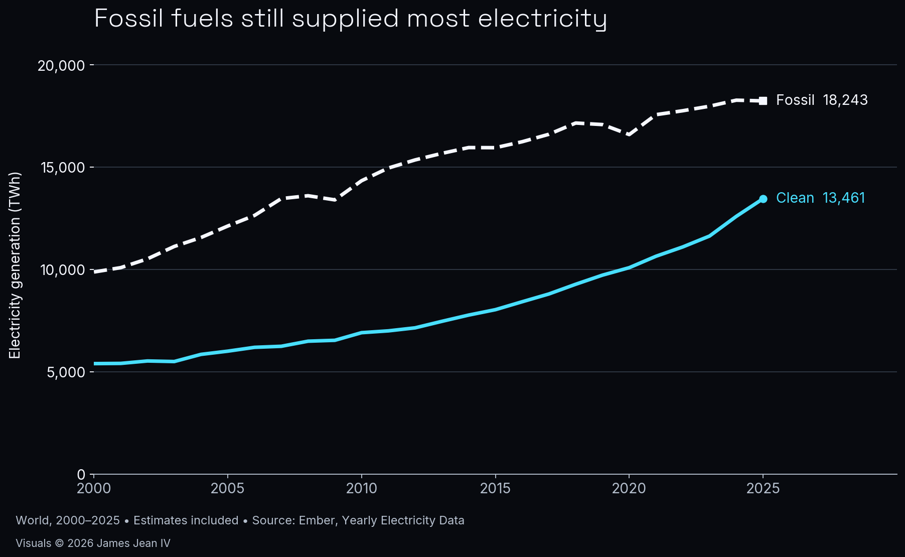

# Daily Data Stories: Global Clean Electricity

Analyzed Ember annual global electricity-generation history from 2000 through 2025, comparing fossil and clean generation.

**Evidence snapshot:** Executed public-data analysis

World electricity generation, 2000–2025; estimates included. Source: Ember, Yearly Electricity Data (CC BY 4.0). Original visualization by James Jean IV. Annual generation is not an hourly-reliability or causal-displacement measure.

## What the work demonstrates

Public-data case study

## Scope and next step

Includes estimates. Annual totals describe generation and do not establish causal displacement or hourly system reliability. Data: Ember, CC BY 4.0.

[Back to the project gallery](README.md)
