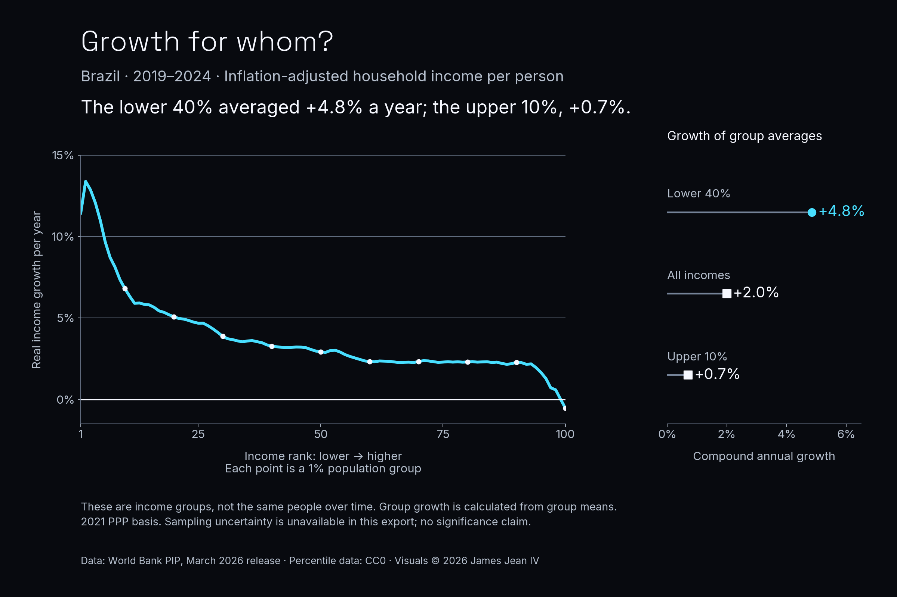

# Daily Data Stories: Growth Across Incomes

Compared Brazil’s 2019 and 2024 income distributions using the March 2026 World Bank PIP release. Compound growth of group means was 4.8% per year for the lower 40% and 0.7% for the upper 10%.

**Evidence snapshot:** Executed public-data analysis

World Bank PIP, March 2026 release, 2021 PPP basis. Growth compares income-group averages, not the same people. The preserved figure reflects its historical CC0 receipt; the current catalog lists CC BY 4.0. Retain source attribution. Independent visual by James Jean IV; no World Bank endorsement.

## What the work demonstrates

Public-data case study

## Scope and next step

Income groups do not track the same individuals; no sampling intervals or causal inference are available. Historical PIP receipt: CC0; current catalog: CC BY 4.0. Saved executed notebook; helper scripts and raw snapshots are omitted, so this extract is not standalone runnable. No analysis was rerun for this portfolio update.

## Explore

- [Case study](https://james-jean-data-science.s3r3bii.chatgpt.site/assets/project-downloads/daily-data-stories/2026-09-17-growth-across-incomes/case-study.md)
- [Saved executed notebook](https://james-jean-data-science.s3r3bii.chatgpt.site/assets/project-downloads/daily-data-stories/2026-09-17-growth-across-incomes/analysis/growth_incidence.ipynb)
- [Methodology](https://james-jean-data-science.s3r3bii.chatgpt.site/assets/project-downloads/daily-data-stories/2026-09-17-growth-across-incomes/methodology.md)
- [Sources and reuse](https://james-jean-data-science.s3r3bii.chatgpt.site/assets/project-downloads/daily-data-stories/2026-09-17-growth-across-incomes/REUSE.md)

[Back to the project gallery](README.md)
