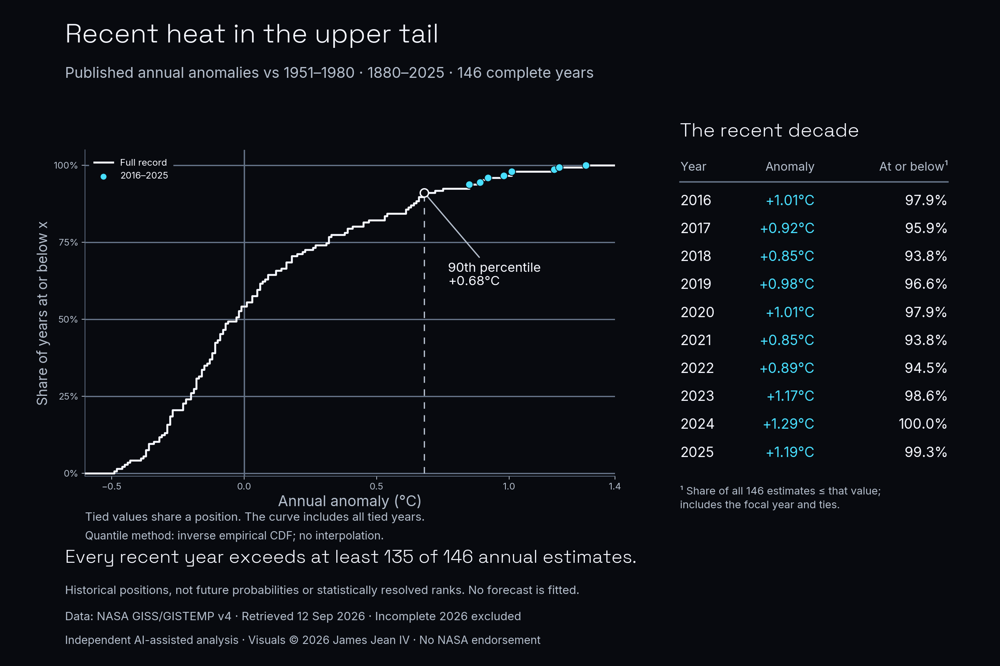

# Daily Data Stories: Temperature Record

Analyzed NASA GISTEMP annual temperature anomalies over 146 complete years, preserving published ties and comparing the recent decade with the historical distribution.

**Evidence snapshot:** Executed public-data analysis

NASA GISS/GISTEMP v4, retrieved 12 September 2026; annual estimates for 1880–2025 relative to 1951–1980. Historical distribution positions are not forecasts or statistically resolved ranks. Independent AI-assisted analysis by James Jean IV; no NASA endorsement.

## What the work demonstrates

Public-data case study

## Scope and next step

Central estimates do not resolve uncertainty between adjacent years. The baseline is 1951–1980, not preindustrial; incomplete 2026 is excluded. Saved executed notebook; helper scripts and raw snapshots are omitted, so this extract is not standalone runnable. No analysis was rerun for this portfolio update.

## Explore

- [Case study](https://james-jean-data-science.s3r3bii.chatgpt.site/assets/project-downloads/daily-data-stories/2026-09-14-temperature-record/case-study.md)
- [Saved executed notebook](https://james-jean-data-science.s3r3bii.chatgpt.site/assets/project-downloads/daily-data-stories/2026-09-14-temperature-record/analysis/temperature_record.ipynb)
- [Methodology](https://james-jean-data-science.s3r3bii.chatgpt.site/assets/project-downloads/daily-data-stories/2026-09-14-temperature-record/methodology.md)
- [Sources and reuse](https://james-jean-data-science.s3r3bii.chatgpt.site/assets/project-downloads/daily-data-stories/2026-09-14-temperature-record/REUSE.md)

[Back to the project gallery](README.md)
