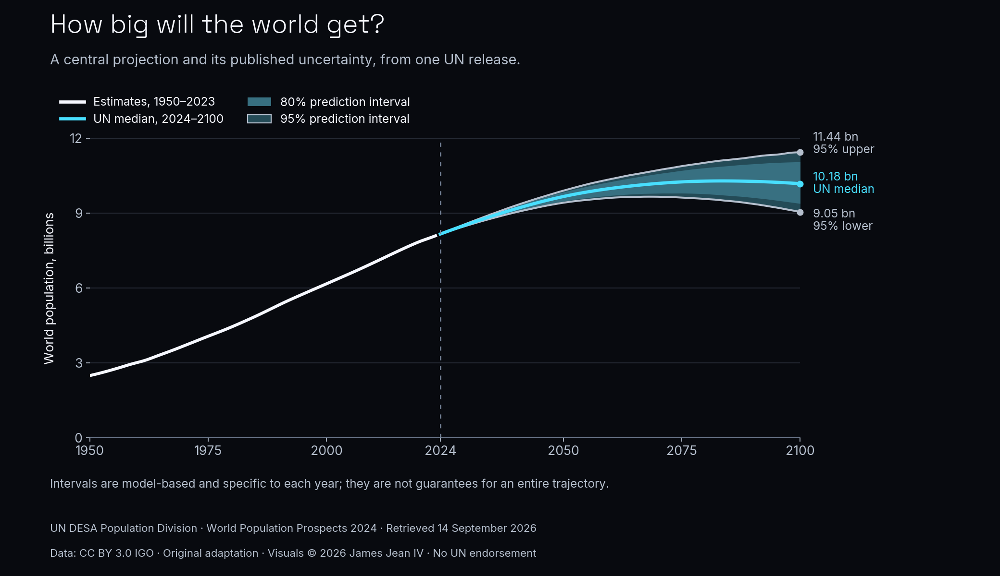

# Daily Data Stories: World Population Projections

Explained the UN World Population Prospects 2024 median projection and its 80% and 95% prediction intervals, distinguishing historical estimates from model-based projections.

**Evidence snapshot:** Executed public-data analysis

UN DESA Population Division, World Population Prospects 2024, retrieved 14 September 2026. Data: CC BY 3.0 IGO. Original analytical and visual adaptation by James Jean IV; no UN endorsement. Intervals are year-specific, not whole-trajectory guarantees.

## What the work demonstrates

Public-data case study

## Scope and next step

The UN produced the population model and projections. Intervals apply separately to each year and do not guarantee a complete trajectory. Historical analytical draft. Saved executed notebook; helper scripts and raw snapshots are omitted, so this extract is not standalone runnable. No analysis was rerun for this portfolio update.

## Explore

- [Case study](https://james-jean-data-science.s3r3bii.chatgpt.site/assets/project-downloads/daily-data-stories/2026-09-16-world-population-projections/case-study.md)
- [Saved executed notebook](https://james-jean-data-science.s3r3bii.chatgpt.site/assets/project-downloads/daily-data-stories/2026-09-16-world-population-projections/analysis/world_population_projections.ipynb)
- [Methodology](https://james-jean-data-science.s3r3bii.chatgpt.site/assets/project-downloads/daily-data-stories/2026-09-16-world-population-projections/methodology.md)
- [Sources and reuse](https://james-jean-data-science.s3r3bii.chatgpt.site/assets/project-downloads/daily-data-stories/2026-09-16-world-population-projections/REUSE.md)

[Back to the project gallery](README.md)
