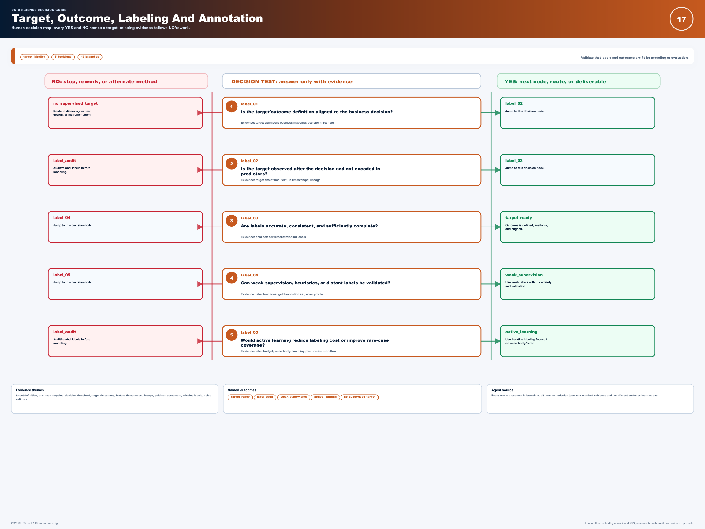

# Data Science Decision Reference

Created a 38-page decision guide connecting analytical questions to methods, evidence requirements and delivery checks. The atlas presents 22 routes, 137 decision nodes and 274 yes/no branches.

**Evidence snapshot:** Educational resource

An actual page from the existing 38-page Decision Atlas. The guide structures analytical judgment; this is not a software execution result.

## What the work demonstrates

Independent educational resource

## Scope and next step

Educational guide; structural counts do not establish analytical correctness or business impact. Companion JSON, schemas and audit files referenced in the PDF are not included.

## Explore

- [Decision Atlas · 38-page PDF](https://james-jean-data-science.s3r3bii.chatgpt.site/assets/project-downloads/decision-reference/decision-atlas.pdf)

[Back to the project gallery](README.md)
