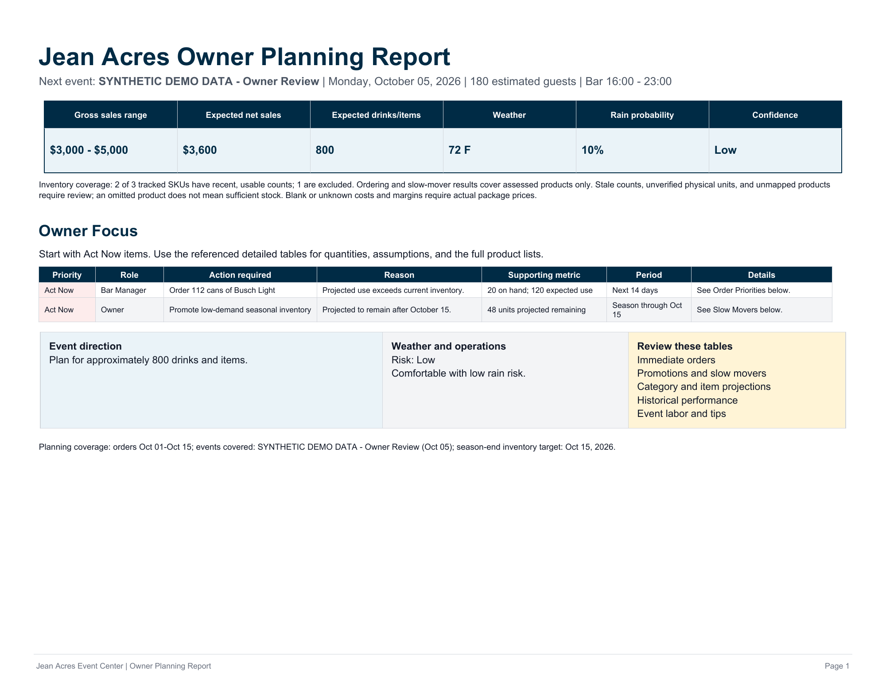

# JeanAcres Owner Reporting

Built an owner-reporting application that assembles operational summaries from normalized sales and stock inputs. The example report was generated by the application using an explicitly synthetic test fixture.

**Evidence snapshot:** Synthetic application demonstration

Report generated by the existing application using synthetic event and inventory inputs. Demonstrates report generation, not business performance.

## What the work demonstrates

Independent application

## Scope and next step

The example demonstrates report generation. Its sales, inventory and event values are synthetic; it does not measure business performance or adoption.

[Back to the project gallery](README.md)
