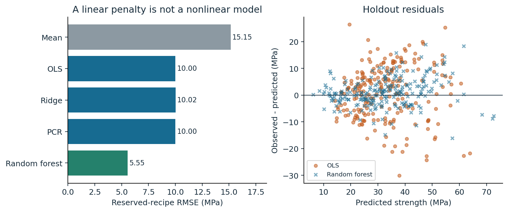

# Mathematical Portfolio Study

Separate numerical accuracy, identification and predictive adequacy before choosing a remedy.

**Evidence snapshot:** Executed study - AI-assisted

The frozen recipe-grouped holdout retains the negative ridge result. This existing plot comes from the executed study.

## What the work demonstrates

AI-assisted derivations, implementations and independent checks connect SVD, ridge, gradient descent, Gaussian uncertainty and KKT conditions.

## Scope and next step

An expository study and bounded empirical analysis. No new theory, causal effect, engineering deployment or claim of unaided mastery.

## Explore

- [Explore the evidence](https://james-jean-data-science.s3r3bii.chatgpt.site/assets/math-study-v3/index.html)

[Back to the project gallery](README.md)
