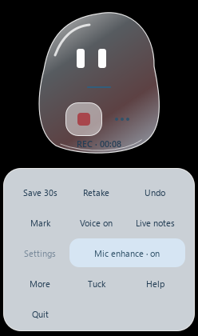

# PikiVu

A Windows recording and editing application that preserves original media while turning captured sessions into reviewable exports.

**Evidence snapshot:** Private development release 0.10.4, verified October 27, 2026

Actual controls captured during the packaged 0.10.4 recording check. The private application source is not distributed.

## What the work demonstrates

Desktop product design; audio/video processing; guarded edit workflows; packaged application validation.

## Scope and next step

The recorded checks cover bounded capture and edit scenarios. Long-session synchronization and broad device compatibility are separate validation work. Source, models, recordings and installers are private.

[Back to the project gallery](README.md)
