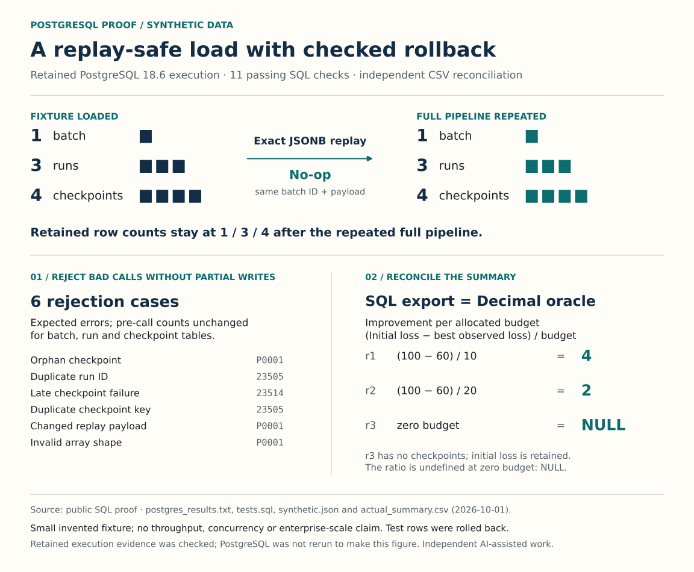

# PostgreSQL Data Integrity

Transactional batch loading, analytical SQL and independent reconciliation using a fictional research-data fixture.

**Evidence snapshot:** Published source and retained execution evidence

Project output; see the status and evidence below.

## What the work demonstrates

SQL; transaction design; replay and rollback checks; Python cross-checks.

## Scope and next step

Small synthetic example; the retained eleven SQL assertions do not establish production throughput.

## Explore

- [Browse source and notebook](https://github.com/S3R3Bii/postgresql-data-integrity)

[Back to the project gallery](README.md)
