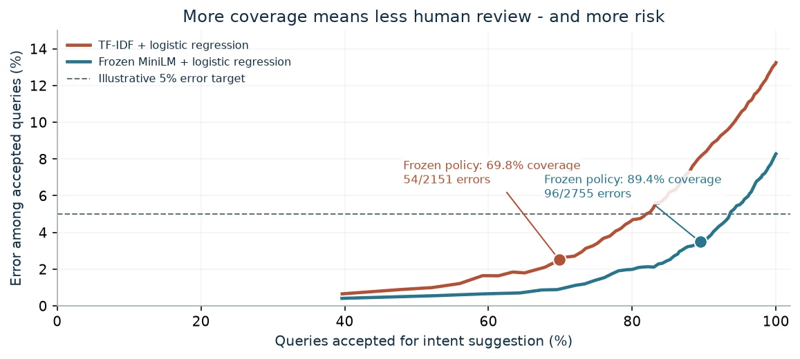

# Banking Intent Atlas

**Knowing when an NLP router should defer.** An executed, AI-assisted engineering study comparing a lexical baseline with a frozen pretrained sentence encoder on BANKING77, then turning calibrated confidence into an inspectable human-review policy.

[Interactive case study](https://james-jean-data-science.s3r3bii.chatgpt.site/assets/banking-intent-atlas/index.html) · [Seven-page visual paper](showcase/Banking_Intent_Atlas.pdf) · [Frozen protocol](PROTOCOL.md) · [Independent audit](outputs/independent_audit.json)

## Result and decision

On the official 3,080-query test, **frozen MiniLM + logistic regression reached 91.72% top-1 accuracy**, versus **86.75% for TF-IDF + logistic regression**. The paired improvement was 4.97 percentage points, with a 2,000-resample query-bootstrap interval of 3.86–6.07 points. This compares two complete fixed pipelines, not an isolated causal effect of embedding choice.

The semantic model's policy, selected before final testing, accepts confidence ≥0.66: **2,755 accepted, 325 referred, 96 accepted errors (3.48%; 95% Wilson interval 2.86–4.24%)**. Its lexical counterpart accepts fewer queries and makes fewer accepted errors. Review capacity and error tolerance determine which tradeoff is useful.



**Recommendation:** a supervised intent-suggestion pilot, with human escalation and a separately validated domain gate. The semantic policy also accepted **two of twelve synthetic non-banking probes**, so maximum probability is not a reliable domain check. This is a small authored challenge set, not a population error estimate. No banking action, deployment, cost saving or research novelty is claimed.

## What is implemented

- Pinned, licensed public inputs and SHA-256 source receipts.
- Exact-normalized duplicate, conflicting-label and train/test overlap audit; 62 training rows excluded.
- Seeded fit/calibration/policy partitions of 6,958 / 1,491 / 1,492 queries, plus the separate official test.
- TF-IDF word unigrams/bigrams and frozen 384-dimensional MiniLM ONNX embeddings; one logistic classifier per representation.
- Temperature scaling and a coverage-maximizing referral policy, frozen before test evaluation.
- Per-query predictions, paired uncertainty, calibration/error analysis and retained out-of-domain failures.
- SQLite lineage and reconciliation queries; an independent standard-library audit reconstructing key metrics.
- Local fresh-inference CLI; a browser evidence explorer that replays saved predictions without external model calls.

## Reproduce without overwriting evidence

Python **3.12** was used; direct dependencies are pinned in `requirements.txt`. Training runs on CPU. Internet is needed only to fetch the public dataset and model weights (roughly 90 MB). No API key or paid model service is required.

```sh
python -m venv .venv
# Activate .venv for your shell, then:
python -m pip install -r requirements.txt
python reproduce.py --output ../banking-intent-reproduction
```

The destination must not exist. The helper copies source and the original protocol, then downloads pinned sources, prepares data, trains, evaluates, audits and renders the paper in the new directory. It does not overwrite this retained release. The pipeline's own guards reject replacing locked results. Numerical outputs may vary slightly with library/CPU versions; compare the declared environment and source hashes.

For fresh predictions after reproduction:

```sh
cd ../banking-intent-reproduction
python pipeline.py predict --text "My card has not arrived yet"
```

This prints candidate intents, calibrated probabilities and the frozen referral decision. It is not a banking assistant, domain detector or instruction to act.

For the static evidence explorer, serve `showcase/` with any local static server. Opening `index.html` directly under `file://` may block the evidence fetch. To check its calculations and application events without a browser:

```sh
node test_ui.mjs
```

## Evidence map

| File | Purpose |
|---|---|
| `PROTOCOL.md` | Analysis and policy rules written before evaluation |
| `fetch_sources.py`, `outputs/source_manifest.json` | Pinned upstream revisions, source locations and hashes |
| `pipeline.py` | Data audit, model fitting, calibration, policy lock, evaluation and inference |
| `outputs/split_manifest.csv.gz` | Row identity, class and text fingerprint for every retained query |
| `outputs/policy_lock.json` | Model selection and cutoffs fixed before final-test scoring |
| `outputs/predictions.csv.gz` | All 6,160 final-test model/query records without raw message text |
| `outputs/metrics.json`, `ood_probes.json` | Full comparison, uncertainty and retained failures |
| `audit.py`, `queries.sql` | Independent metric reconstruction and SQL checks |
| `build_artifacts.py` | Source-driven figures, paper and compact browser data |
| `showcase/` | Seven-page PDF and static interactive evidence explorer |

The two large CSVs are stored as lossless gzip files in this public release; `outputs/compressed_evidence.json` records their uncompressed hashes. Reproduction emits the original CSVs.

## Important limits

English, fixed 77-intent classification; no user, timestamp or institution-group holdout is possible from these fields. Fingerprints remove exact-normalized overlap, not semantic duplicates. The official test contains four duplicate rows and one conflicting-label fingerprint group; the separate deduplicated/unambiguous sensitivity result is in `metrics.json`. Pretrained-model exposure to related text cannot be ruled out. Row-level intervals condition on the benchmark and do not account for training-seed variation, latent customer grouping or future drift. Threshold selection on the policy split is a heuristic, not a post-selection guarantee; the separate test measures the locked choice.

Browser calculations and events were checked with a Node test harness. The PDF was rendered and inspected. Live desktop browser visual/interaction QA was unavailable at release because the existing desktop connection denied access; responsive styling and semantic labels are implemented, but accessibility conformance is not claimed.

## Sources, attribution and authorship

- Casanueva et al. (2020), [Efficient Intent Detection with Dual Sentence Encoders](https://aclanthology.org/2020.nlp4convai-1.5/). [BANKING77 dataset](https://github.com/PolyAI-LDN/task-specific-datasets), **CC BY 4.0**, revision `57ec275d8078af65b7731c2a98be812d844a6d6b`. Selected examples, labels and derived results are attributed to this source; preprocessing and derived outputs are identified above.
- [Sentence Transformers all-MiniLM-L6-v2](https://huggingface.co/sentence-transformers/all-MiniLM-L6-v2), **Apache 2.0**, revision `1110a243fdf4706b3f48f1d95db1a4f5529b4d41`. Frozen weights are downloaded, not redistributed here.
- Guo et al. (2017), [On Calibration of Modern Neural Networks](https://proceedings.mlr.press/v70/guo17a.html), temperature-scaling motivation.

James N. Jean IV defined the portfolio objective. ChatGPT Codex substantially assisted design, implementation, execution, verification, writing and presentation. This is new independent portfolio work, not prior professional NLP tenure. Dataset/model rights remain with their respective owners. Original source and prose follow the parent portfolio's copyright terms; no broader license is granted by this release.
