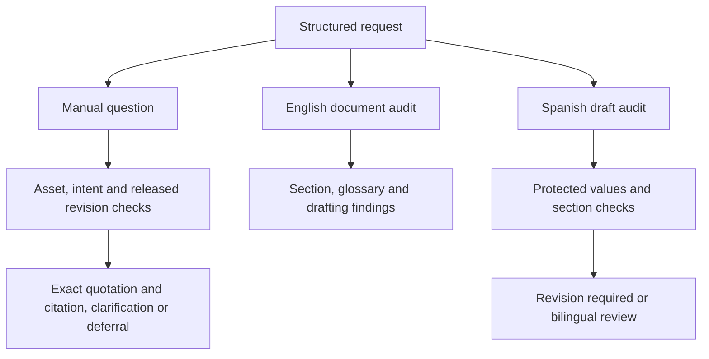

# Service Manual AI Lab

A field engineer looking up a retry interval should be able to see which manual supports the answer. A localization reviewer should be able to catch a changed duration or missing ticket placeholder before publishing. This prototype brings those checks into one Python workflow for two fictional report-upload products.

| Workflow | Demonstrated outcome |
| --- | --- |
| Ask a manual | For Atlas A1, the assistant cites the released 15-minute interval in revision 1.4. A plain search returned the retired 30-minute interval in revision 1.3. |
| Proofread a draft | An English draft has a missing export section, a duplicated retry section, an unresolved drafting marker, and a term that disagrees with the glossary. The tool lists all four with their locations. |
| Review a Spanish draft | The altered fixture changes a wait time and loses a format identifier and ticket placeholder. The checker flags these and other structural changes. A clean check routes to a bilingual reviewer. |

## Run locally

Use Python 3.10+ with SQLite FTS5. The demo operates on the included fictional fixtures and runs offline after dependency installation.

```sh
python -m pip install -r requirements.txt
python manualqa.py ask --asset "Atlas A1" "What is the retry interval?"
python manualqa.py ask "What is the retry interval?"
python manualqa.py audit 1.5
python manualqa.py localize altered
python manualqa.py localize complete
python -m unittest -v
python evaluate.py
```

The first result returns `15 minutes` inside a verbatim quotation with an `Atlas A1 / 1.4 / retry` citation. The same question without the asset prompts for clarification. Each run returns the result and workflow stages as JSON.

## Design



LangGraph routes the request to one of three local tools. Questions use a small supported-intent grammar and SQLite FTS5 retrieval. The assistant requires a specified asset and one released English revision with a unique matching passage. A conflicting release, unsupported question, or missing passage defers. English and Spanish audits check bounded fixture rules, including supported number words, units, section order, format codes, URLs and template variables. The program leaves publication to the reviewer.

## Evidence and limits

On [11 authored question scenarios](evidence.json), the guarded workflow met all 11 expected outcomes. Plain SQLite search matched 6 of 11. The cases include seven answerable questions, three unsupported requests, and one missing-asset request. For a supported answer, the scorer requires the correct asset, version, section and answer fragment. For the other cases, it checks whether the workflow defers or asks for clarification. Plain search receives credit whenever it returns no passage on those cases. The corpus and regression cases were co-designed, and the comparison measures a bundle of routing and release controls. These counts describe the fixtures only. Eight unit tests also check citation readback, conflicting releases, document findings, and translation review behavior.

This offline implementation extracts cited answers and checks supplied translation drafts. It has no live LLM, automatic translation, persistent conversation memory or production integration. Passing the checks cannot establish translation fluency or semantic equivalence. The next evaluation would use independently authored questions against a larger set of versioned manuals and bilingual reviewer judgments.

## Related work

- [Banking Intent Atlas](../../banking-intent-atlas.md) compares NLP intent-routing approaches and examines when a system should defer.
- [Agent Evaluation Workbench](../../agent-evaluation-workbench.md) compares agent outputs against explicit task evidence and retains failed checks.
- [Certified Analysis Decision Revision](../../certified-analysis-decision-revision.md) examines when new evidence justifies revising a decision.
